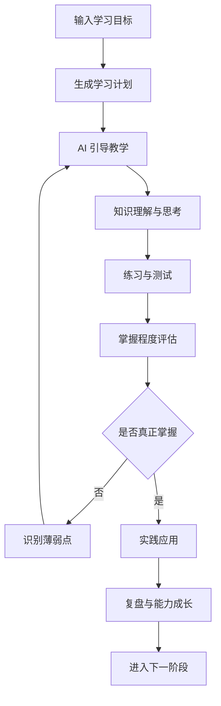

# DoKnow

<p align="center">
  <strong>Know. Do. Grow.</strong>
</p>

<p align="center">
  知而后行 · 行而后知
</p>

<p align="center">
  An Open-Source AI Learning Companion
</p>

<p align="center">
  <a href="#-项目介绍">项目介绍</a> ·
  <a href="#-核心理念">核心理念</a> ·
  <a href="#-核心功能">核心功能</a> ·
  <a href="#-技术架构">技术架构</a> ·
  <a href="#-项目规划">项目规划</a>
</p>

---

## 📖 项目介绍

**DoKnow 是一个开源的 AI 学习助手，致力于帮助每个人真正掌握知识，并将知识转化为实际能力。**

在 AI 时代，获取知识已经变得越来越容易。

我们可以让 AI 解释一个概念、总结一本书、生成一份学习计划，甚至直接给出问题的答案。

但有一个更重要的问题：

**你真的学会了吗？**

DoKnow 希望解决的不只是知识获取问题，而是从知识理解到实践应用的完整学习过程。

它不仅是一个能够回答问题的 AI Chatbot，更是一个能够理解学习目标、制定学习计划、引导思考、安排练习、评估掌握程度，并根据学习情况动态调整教学策略的 AI Learning Companion。

我们的目标是：

**让 AI 不只是告诉你答案，而是帮助你真正具备解决问题的能力。**

## 💡 核心理念

DoKnow 的设计理念来源于中国传统哲学中的「知行合一」。

> 未有知而不行者，知而不行，只是未知。
>
> —— 王阳明

我们认为，真正的学习不应该止步于理解知识。

- **Know**：获取知识、理解概念、掌握原理。
- **Do**：动手实践、解决问题、应用知识。
- **Grow**：复盘总结、持续进步、形成能力。

学习不是简单地记住答案，而是通过理解、思考、练习和实践，让知识真正成为自己的能力。

## ✨ 核心功能

DoKnow 计划围绕完整的学习闭环构建以下能力：

### 1. AI Learning Planner

AI 学习规划师

- 根据学习目标生成个性化学习路线。
- 根据用户基础水平拆解知识体系。
- 自动生成章节、知识点和学习任务。
- 根据学习进度动态调整学习计划。

### 2. AI Tutor

AI 智能导师

- 从零开始讲解复杂知识。
- 根据学习者水平调整讲解难度。
- 通过追问和反问引导独立思考。
- 结合实例帮助理解抽象概念。
- 根据用户反馈调整教学策略。

### 3. AI Assessment

AI 智能评估

- 自动生成选择题、简答题和编程题。
- 根据回答进行智能批改。
- 分析知识薄弱点和理解误区。
- 生成针对性的巩固练习。
- 持续跟踪知识掌握程度。

### 4. Knowledge Base

个人知识库

- 支持 PDF、Word、Markdown 等资料导入。
- 自动提取文档中的核心知识点。
- 建立知识点之间的关联。
- 基于个人知识库进行 AI 问答。

### 5. Learning Memory

学习记忆

- 记录学习历史和答题情况。
- 跟踪知识点掌握状态。
- 识别长期薄弱知识点。
- 根据遗忘规律安排复习任务。

### 6. Practical Training

实战训练

- AI 根据学习目标生成实践任务。
- 通过真实问题检验知识掌握程度。
- 分析代码、方案或实践结果。
- 提供改进建议并逐步提高任务难度。

## 🔄 学习闭环

DoKnow 不希望用户只停留在与 AI 对话，而是建立完整的学习反馈循环。



**核心原则：根据学习效果决定下一步，而不是简单按照固定课程推进。**

## 🧠 Agent 设计理念

DoKnow 采用 Workflow + Agent 相结合的设计方式。

不是所有任务都需要 Agent。

- Workflow：处理确定性较强的任务，例如学习计划生成、知识点排序、测试判分。
- Agent：处理需要动态判断的任务，例如教学策略选择、学习路径调整和个性化引导。
- Tools：为 Agent 提供讲解、提问、出题、评估、复习等能力。
- Memory：记录学习者的历史表现和知识掌握情况。

学习 Agent 的基本工作流程：

```text
Observe → Think → Act → Reflect
```

让 AI 根据学习者的真实反馈持续调整教学行为。

## 🛠 技术架构

DoKnow 采用前后端分离架构，保持模块化设计，支持不同 AI 模型接入。

| 技术领域 | 技术选型 |
|---|---|
| Frontend | Vue 3 + TypeScript |
| Backend | Python + FastAPI |
| Database | PostgreSQL |
| Vector Database | pgvector |
| Agent Framework | LangGraph |
| Cache | Redis |
| Document Parsing | Docling / MinerU |
| Deployment | Docker |

AI 模型支持可扩展设计，避免绑定单一模型供应商。

## 🚀 快速开始

项目目前处于早期建设阶段，安装和部署文档将随着开发逐步完善。

```bash
git clone https://github.com/<your-username>/DoKnow-AI.git

cd DoKnow-AI
```

配置文件、环境变量和 Docker 部署说明将在后续版本中补充。

## 🗺 项目规划

- [ ] 项目基础架构搭建
- [ ] 用户学习目标管理
- [ ] AI 学习计划生成
- [ ] AI Tutor 智能教学
- [ ] AI 自动出题与答题评估
- [ ] 学习进度与知识掌握记录
- [ ] 个人知识库与 RAG
- [ ] 学习记忆与智能复习
- [ ] Agent 实战训练
- [ ] 多模型支持
- [ ] Docker 一键部署

## 🌱 开源愿景

DoKnow 不只是一个 AI 应用，也是一个持续探索 AI Agent 与智能教育的开源项目。

我们希望：

- 让每个人都拥有自己的 AI 导师。
- 让学习从被动获取知识转向主动探索。
- 让 AI 从答案生成器进化为能力培养助手。
- 让知识真正转化为解决问题的能力。

欢迎对 AI、Agent、教育技术感兴趣的开发者一起参与。

## 🤝 Contributing

欢迎提交 Issue、提出建议和参与代码贡献。

## 📄 License

MIT License

---

<p align="center">
  <strong>DoKnow — Know. Do. Grow.</strong>
  <br/>
  知而后行 · 行而后知
</p>
