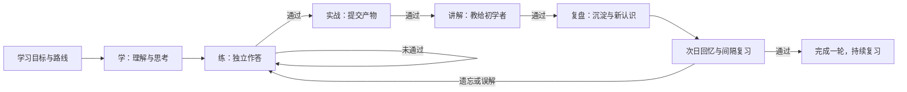

<div align="center">

# DoKnow

### Know. Do. Grow.

**知而后行 · 行而后知**

An Open-Source AI Learning Companion

先学，再练，再实战，再给别人讲解，再回看。

把知识变成可检验、可复用的能力。

</div>

## 项目介绍

DoKnow 是一个开源的 AI 学习助手，帮助学习者从“听懂了”走到“做得到、讲得清、过一段时间仍能用”。它记录目标、学习反思、练习表现、实践产物、讲解稿和复盘笔记，根据证据推进学习，而不是只提供聊天答案。

首版已经具备 Vue 3 + TypeScript 前端、Python + FastAPI 后端和持久数据库。无需模型密钥即可运行体验模式；配置兼容模型服务后可使用 AI 规划、导师追问、实践评价和资料问答。

## 完整学习闭环



学习阶段写出自己的理解；练习由后端判分；实战提交代码、方案或观察结果；讲解时提供原理、例子与边界；复盘留下可复用的经验，并说明理解或做法发生了什么变化。复盘后安排次日回忆，成功后逐步延长复习间隔。仅点击页面无法越过阶段约束。

| 理念 | 具体行为 |
| --- | --- |
| 知行合一 | 理解后必须应用，以产物检验理解 |
| 学而时习之 | 主动回忆与间隔复习，结合中西学习方法 |
| 学思结合 | 自己写理解，导师通过追问引导思考 |
| 学不可以已 | 完成一轮后仍安排复习与巩固 |
| 格物致知 | 用观察、实例和适用边界检查原理 |
| 闻思修 | 讲解输入、独立思考、亲身练习相连接 |
| 教学做合一 | 先实践，再用自己的话教给别人 |

详细规则见 [学习设计](docs/LEARNING_DESIGN.md)。

## 已实现的能力

- **概念知识图谱**：输入想学的领域，构建知识实体和“属于、依赖、使用、优化、应用于”等语义关系；实体、关系与属性独立持久化。Cytoscape.js 展示可拖拽的关系网络，支持别名搜索、关系筛选、邻域展开、关联路径、来源标记及 JSON 导出。内置 4 类示例知识库；接入模型后可构建其他主题。详见 [知识图谱](docs/KNOWLEDGE_MAP.md)。
- **学习规划**：设置目标、基础和每日时间，生成知识单元、讲解、练习、实战与讲解任务；可编辑目标名称、动机和每日时间，保留原课程、进度和历史。
- **课程调整**：未开始部分可重生成、调整难度或重排；先预览再确认，固定保留已有学习记录的单元，旧材料只读归档，记录课程版本和变更历史。规则见 [课程调整与证据保留](docs/COURSE_ADJUSTMENTS.md)。
- **智能导师**：结合当前单元和对话历史选择追问、例子、提示或复盘策略，保留教学记录。
- **练习与评估**：新单元提供多题与变式，答错后轮转补练，全部通过再进入实战；服务端核对题目标识，防止旧页面误答下一题。
- **评价来源与历史**：区分体验结构检查、AI 语义评价和答案核对，保留每次模型与规则信息；学习足迹可筛选评价和错题，旧记录明确标为来源未知。
- **个人知识库**：保存和编辑笔记，管理标签、组合搜索与来源筛选，导出 Markdown；导入 Markdown、TXT、PDF、Word，检索当前内容并附来源回答。编辑保留原始记录，多页面保存冲突需要核对后处理。
- **学习记忆**：刷新后恢复目标和历史，记录答题、提交、复盘与历次复习。
- **草稿与提交恢复**：按单元和阶段保存本地草稿，未确认的操作可继续确认；写入成功后的页面同步失败不会要求重新提交。
- **数据保护**：启动时检查数据库版本，提供 SQLite 一致性备份、校验和恢复到新文件的命令。
- **实战与讲解**：提交应用产物，再向初学者解释，避免学习只停在知识输入。
- **沉淀与复习**：复盘自动生成知识笔记，次日开始回忆，遗忘后回到练习。
- **模型接入与部署**：体验模式、OpenAI / 兼容接口，SQLite 本地启动，PostgreSQL + Redis Docker 部署。

## 快速开始

需要 Python 3.11+、Node.js 22+。Windows 可在安装下述依赖后，使用项目根目录入口：

```powershell
.\doknow.ps1 diagnose --demo
.\doknow.ps1 start --demo
.\doknow.ps1 stop
```

`--demo` 使用独立体验库，不访问正式学习数据。去掉该参数沿用现有配置与学习库，启动前先备份。诊断只读，不会隐式建库或迁移；启停只管理本工具启动的服务。端口参数、缺依赖/启动故障处理、JSON 输出和执行策略兼容方式见 [本地运行与诊断](docs/LOCAL_RUNNING.md)。设置页可刷新安全运行状态。

以下双终端手动启动方式继续保留，在项目 `DoKnow` 目录操作。

**终端一：后端（推荐 uv）**

```powershell
cd backend
uv sync --extra dev
uv run uvicorn app.main:app --host 127.0.0.1 --port 8000
```

也可以使用 Python 自带 venv：

```powershell
cd backend
python -m venv .venv
# Windows
.venv\Scripts\python -m pip install -r requirements.lock
.venv\Scripts\python -m uvicorn app.main:app --host 127.0.0.1 --port 8000
# macOS / Linux 使用 .venv/bin/python
```

**终端二：前端**

```powershell
cd frontend
npm ci
npm run dev
```

打开 [http://localhost:5173](http://localhost:5173)。交互式 API 文档位于 [http://localhost:8000/docs](http://localhost:8000/docs)。前端开发服务器代理 `/api` 到后端。

默认不用创建 `.env`。先建立“学习 Python 基础”等目标，完成一轮学习；体验课程还包含英语与批判性思维主题，其他目标采用通用学习模板。

已有首版数据会在启动时检查结构并升级。升级前先按 [数据升级、备份与恢复](docs/DATA_MANAGEMENT.md) 创建备份；未知结构或较新数据库版本会拒绝启动，原文件应保留用于排查。

新版保留旧单题课程和历史学习证据。新建目标可使用多题练习：体验课程每单元三题，AI 课程每单元三至五题。进度会在刷新或重启后恢复，回忆失败时开启新一轮巩固。

草稿保存于当前浏览器；切换学习单元、页面刷新后可以继续写。浏览器存储受限时会提示，草稿不包含在数据库备份中，也不跨设备同步。页面保持打开或重新回到前台时，会更新复习到期状态。

如果提交后连接中断，页面会保留原文和“待确认的操作”。点击“确认上次操作”可以核对并完成同一次操作；资料导入需要重新选择相同文件。确认成功后的独立新提交会创建新的记录。

## 配置 AI 模型

将 `backend/.env.example` 复制为 `backend/.env`，填写服务端配置，重启后端：

```dotenv
AI_PROVIDER=compatible
AI_BASE_URL=https://your-provider.example/v1
AI_MODEL=your-model-name
AI_API_KEY=your-secret-key
```

OpenAI 服务可设置 `AI_PROVIDER=openai` 和 `AI_BASE_URL=https://api.openai.com/v1`。支持兼容 Chat Completions 的模型，并要求规划、评价支持 JSON 对象输出。本机模型可使用 `http://localhost:端口/v1`，无认证本机服务的密钥可填占位值。

模型故障会显示错误，操作不会推进学习记录。不会在模型故障时悄悄改用体验结果。密钥不会返回前端，请勿提交 `.env`。

**能力边界**：体验模式的课程来自示例模板，评价仅检查结构性证据，不能证明任意代码或讲解正确，也不能证明真正掌握。AI 评价同样可能出错，应以实际任务结果和可靠资料核验。提交的代码只当文本分析，不会被执行。

配置 AI 后，目标、对话、提交和相关资料片段会发送到你指定的模型服务。

## Docker 一键启动

需要运行中的 Docker Engine / Docker Desktop：

```powershell
Copy-Item .env.example .env
docker compose up --build -d
```

macOS / Linux 使用 `cp .env.example .env`。打开 [http://localhost:8080](http://localhost:8080)。`.env` 中可更改 `DOKNOW_PORT`、数据库密码和模型配置。PostgreSQL 和 Redis 只在容器网络中访问，网页端口默认绑定本机。

```powershell
docker compose logs -f backend
docker compose down
```

`down` 保留数据库卷；删除卷会永久删除学习记录。默认 SQLite 数据在 `backend/data/doknow.db`，Docker 数据在 `doknow_postgres_data` 卷。请在升级前备份。

## 技术架构

| 模块 | 首版实现 |
| --- | --- |
| Frontend | Vue 3、TypeScript、Vite |
| Backend | FastAPI、Pydantic、SQLAlchemy |
| Database | SQLite（本地）、PostgreSQL 16（Docker） |
| Agent | LangGraph：Observe → Think → Act → Reflect 教学策略 |
| Knowledge retrieval | 多语言词法检索、正文摘录和来源引用 |
| Vector database | Docker 预装 pgvector 扩展；语义向量索引尚未接入 |
| Cache | 可选 Redis 资料问答缓存，按资料内容变化失效 |
| Document parsing | pypdf、python-docx、Markdown / TXT；不支持扫描件 OCR |
| Deployment | Docker Compose、nginx 同源代理 |

首版面向**一位本地学习者**，没有账号或多用户隔离，不应直接部署到公网。架构边界见 [架构说明](docs/ARCHITECTURE.md)，接口见 [API 契约](docs/API_CONTRACT.md)。

## 验证与开发

```powershell
cd backend
uv run --extra dev pytest -q
uv run --extra dev ruff check app tests
```

```powershell
cd frontend
npm run typecheck
npm run build
```

后端测试涵盖学习闭环、错题、阶段跳过、复习时间、知识导入、持久化、模型故障与缓存失效。浏览器测试与当前版本验证记录见 [验证说明](docs/VERIFICATION.md)。

## 后续路线

个人本地版的任务顺序、验收标准和后续里程碑见 [开发路线图](docs/ROADMAP.md)。继续开发时先读 [会话交接](docs/HANDOFF.md) 和 [进度记录](docs/PROGRESS.md)。

- [x] 基础架构、目标与学习路线
- [x] 导师、选择题与实践 / 讲解评价
- [x] 学习记录、知识导入和带来源问答
- [x] 学习沉淀、延迟回忆与间隔复习
- [x] 兼容模型接入与 Docker 配置
- [x] 数据库版本迁移、SQLite 备份与恢复
- [x] 浏览器草稿、提交恢复与复习到期刷新
- [ ] 多用户认证、授权、限流和数据隔离
- [ ] 运营监控与实际 PostgreSQL / Redis 部署验证
- [ ] 嵌入模型与 pgvector 语义检索
- [ ] 扫描资料 OCR、复杂版面解析
- [ ] 更多题型、可隔离的代码执行与真实项目评价
- [ ] 根据真实长期学习效果持续校准课程和教学策略

## 贡献与许可

欢迎提交 Issue 和代码改进。请附上可复现步骤、验证方法与能力边界，不要将模板反馈称作真正掌握的证明。

[MIT License](LICENSE)

**DoKnow — Know. Do. Grow. 知而后行 · 行而后知。**
